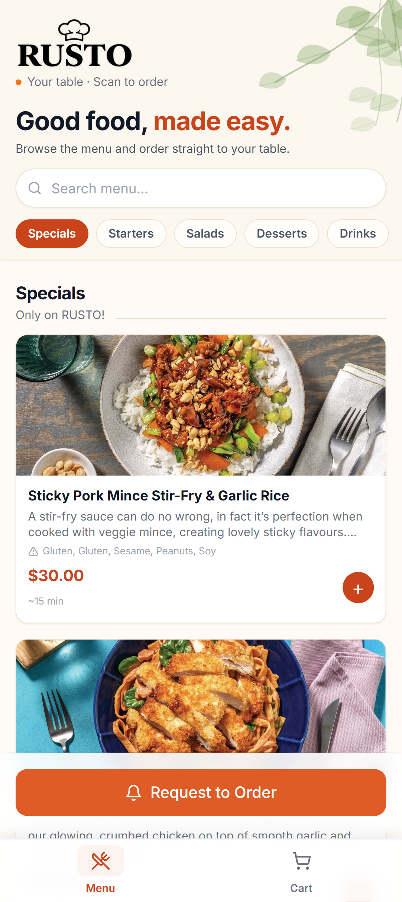
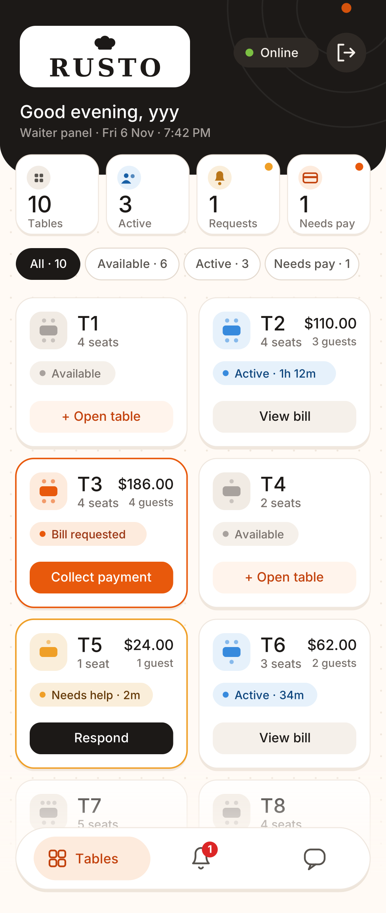
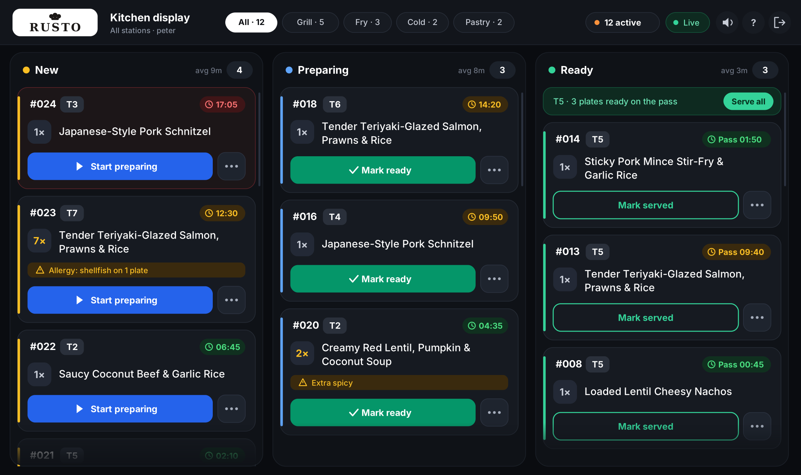
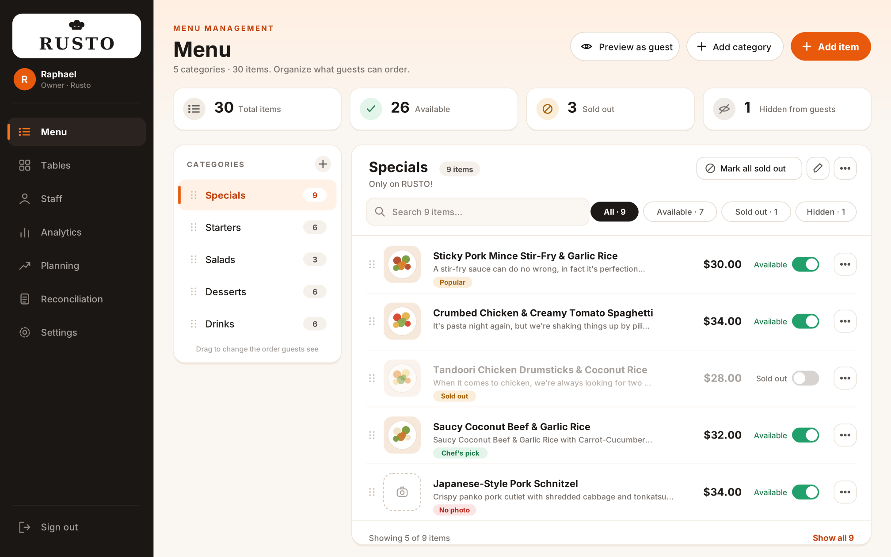

# TableKey 🍽️

A full-stack QR-code restaurant ordering platform. Customers scan a table QR, browse the menu, and order — no app install, no account required. Physical presence is verified by waiter approval and a one-time session code.

**Stack:** React 18 · TypeScript · Tailwind CSS · Zustand · Supabase (Postgres + Realtime + Auth)

## Product tour

TableKey gives every role a focused workspace while keeping the customer journey fast and
app-free:

| Customer ordering | Waiter operations |
|---|---|
|  |  |

| Kitchen display | Manager dashboard |
|---|---|
|  |  |

The customer scans a table QR code, browses the menu, requests waiter approval, and then
places and tracks orders. Staff use the waiter and kitchen workspaces to coordinate service,
while managers oversee menus, tables, staff, planning, payments, and reporting.

---

## Table of contents

1. [Product tour](#product-tour)
2. [Architecture](#architecture)
3. [Prerequisites](#prerequisites)
4. [Quick start](#quick-start)
5. [Supabase setup](#supabase-setup)
6. [Environment variables](#environment-variables)
7. [Running locally](#running-locally)
8. [Demo flow](#demo-flow)
9. [URL structure](#url-structure)
10. [Payments](#payments)
11. [Error monitoring (Sentry)](#error-monitoring-sentry)
12. [Security model](#security-model)
13. [Project structure](#project-structure)
14. [Tests](#tests)
15. [Building for production](#building-for-production)
16. [Migrations reference](#migrations-reference)

---

## Architecture

```
/:venueSlug/t/:tableSlug   → Customer table page   (anonymous)
/login                     → Staff email login      (Supabase Auth)
/pin-login                 → Staff PIN login        (shared devices)
/pair                      → Pair a shared device
/waiter                    → Waiter panel           (role: waiter | manager | admin | owner)
/kitchen                   → Kitchen display (KDS)  (role: kitchen | manager | admin | owner)
/admin/:section            → Admin dashboard        (role: admin | owner)
/invite                    → Staff invite flow
```

### Core flow

```
Customer scans QR
  → Greeting screen (first visit)
  → Browse menu freely
  → "Request to Order" → waiter receives alert
      → Waiter approves in person → 4-digit session code
          → Customer enters code → session verified
              → Add items to cart → place order
                  → Kitchen KDS → Preparing → Ready → Served
                      → Customer tracks order in real time
                          → Bill computed server-side → Payment
```

### Key design decisions

- **Presence-first ordering**: customers can browse without logging in, but cannot place an order without a waiter approving their physical presence. This prevents remote abuse of the ordering system.
- **Server-side money**: `compute_bill`, `record_cash_payment`, `void_item`, `comp_item`, and `close_session_override` are all Postgres RPCs. Client totals are never trusted.
- **Shared-device auth**: kitchen tablets and shared waiter phones use PIN login (`staff_sessions` table) rather than Supabase Auth. A `X-Staff-Token` header is sent on all requests from PIN-authenticated devices.
- **Realtime with polling fallback**: `useTableRealtime` subscribes to Supabase Realtime for auth sessions and falls back to 30-second polling for PIN sessions where the Realtime JWT is unavailable.

---

## Prerequisites

- Node.js 18+
- A [Supabase](https://supabase.com) project (free tier works)
- (Optional) A [Sentry](https://sentry.io) project for error monitoring
- (Optional) A [Stripe](https://stripe.com) account for card payments
- (Optional) A Safaricom Daraja account for M-Pesa payments

---

## Quick start

```bash
git clone <your-repo>
cd TableKey
npm install
cp .env.example .env
# Edit .env with your Supabase credentials
npm run dev
```

---

## Supabase setup

### 1. Create a project

Go to [supabase.com](https://supabase.com) → New project. Note your **Project URL** and **anon public key** from *Settings → API*.

### 2. Run migrations

Run all migration files in order using the Supabase SQL editor or CLI:

```bash
# Using the CLI (recommended)
npx supabase db push

# Or run each file manually in the SQL editor in order:
# 001 → 002 → 003 → ... → 020
```

See [Migrations reference](#migrations-reference) for what each file does.

### 3. Enable Realtime

Go to *Database → Replication* and confirm `supabase_realtime` publication includes:

- `restaurant_tables`
- `table_sessions`
- `table_requests`
- `orders`
- `order_items`
- `payments_v2`
- `help_requests`
- `session_devices`

Migration `001` enables these automatically, but it's worth verifying after a fresh project.

### 4. Create the first admin user

In *Authentication → Users*, create a user (email + password). Then link it to the seed venue:

```sql
INSERT INTO staff (venue_id, user_id, email, name, role, active, joined_at)
VALUES (
  'a1b2c3d4-0000-0000-0000-000000000001',  -- seed venue ID from 002_seed.sql
  '<your-supabase-user-id>',
  'admin@example.com',
  'Admin User',
  'owner',
  true,
  now()
);
```

---

## Environment variables

Copy `.env.example` to `.env` and fill in your values:

```env
# Required
VITE_SUPABASE_URL=https://your-project-ref.supabase.co
VITE_SUPABASE_ANON_KEY=your-anon-key-here

# Base URL for QR code generation — change to your production domain
VITE_APP_URL=http://localhost:5173

# Optional — Stripe card payments
# Leave blank to disable card payments (cash-only mode)
VITE_STRIPE_PUBLISHABLE_KEY=pk_test_...

# Optional — Sentry error monitoring
# Leave blank in development to disable Sentry entirely
# Get your DSN from: sentry.io → Settings → Projects → Client Keys
VITE_SENTRY_DSN=

# Optional — used in Sentry release tagging
VITE_APP_VERSION=0.1.0
```

---

## Running locally

```bash
npm run dev        # Start dev server on http://localhost:5173
npm run build      # Production build → dist/
npm run preview    # Preview the production build locally
```

---

## Demo flow

### Customer

1. Open `http://localhost:5173/demo-venue/t/table-1` (or the URL from Admin → Tables → QR Code)
2. The greeting screen appears on first visit. Tap **Browse Menu**.
3. Browse, add items to cart, then tap **Request to Order**.

### Waiter

1. Open `http://localhost:5173/login` in a separate window.
2. Sign in with your admin credentials.
3. Go to **Requests** — the pending request appears.
4. Tap **Approve** — a code is shown in a toast notification.

### Customer (continued)

5. Enter the 4-digit code. The session is now verified.
6. Add items and place the order.

### Kitchen

7. Open `http://localhost:5173/kitchen` (or sign in on a shared tablet).
8. The order appears in the **New** column.
9. Tap **Start Preparing → Mark Ready → Plated / On Pass**.
10. The customer's order tracking screen updates in real time.

### Waiter (bill)

11. Tap the table card on the Floor view → **Bill** tab.
12. Record cash payment or initiate a card/M-Pesa payment.
13. Once settled, close the table session.

---

## URL structure

| Path | Description |
|------|-------------|
| `/:venueSlug/t/:tableSlug` | Customer table page |
| `/login` | Staff email + password login |
| `/pin-login` | PIN login for shared devices |
| `/pair` | Pair a shared device with a pairing code |
| `/waiter` | Waiter floor view, request queue, help queue |
| `/kitchen` | Kitchen display (kanban: New → Preparing → Ready) |
| `/admin/:section` | Admin dashboard — `menu`, `tables`, `staff`, `analytics`, `planning`, `reconciliation`, `settings` |
| `/invite` | Staff invite acceptance flow |

QR codes are generated in **Admin → Tables**. Download individual PNGs or print a full sheet.

---

## Payments

### Cash

Fully implemented. Waiters record cash payments from the Bill tab. Change due is calculated automatically.

### Card (Stripe)

Requires a Supabase Edge Function. The frontend calls `initiateStripeCheckout` which must hit your Edge Function:

```ts
// supabase/functions/stripe-checkout/index.ts  (starter template)
import Stripe from 'https://esm.sh/stripe@14'

Deno.serve(async (req) => {
  const { paymentId, amount, returnUrl } = await req.json()
  const stripe = new Stripe(Deno.env.get('STRIPE_SECRET_KEY')!)
  const session = await stripe.checkout.sessions.create({
    mode: 'payment',
    line_items: [{
      price_data: {
        currency: 'usd',
        unit_amount: Math.round(amount * 100),
        product_data: { name: 'Table bill' },
      },
      quantity: 1,
    }],
    success_url: `${returnUrl}?stripe=success`,
    cancel_url: `${returnUrl}?stripe=cancel`,
    metadata: { tablekey_payment_id: paymentId },
  })
  return Response.json({ url: session.url })
})
```

Add a webhook for `checkout.session.completed` that calls the `confirm_payment` RPC with the `tablekey_payment_id` from `metadata`.

Store your Stripe secret key in Supabase Vault or as an Edge Function secret — never in the frontend.

### M-Pesa (Safaricom Daraja)

Requires a Supabase Edge Function at `supabase/functions/mpesa-stk/`. The STK push initiates a payment prompt on the customer's phone. A webhook (callback URL) must be configured in the Daraja portal to call `supabase/functions/payment-webhook/`.

Store `MPESA_CONSUMER_KEY`, `MPESA_CONSUMER_SECRET`, `MPESA_SHORTCODE`, and `MPESA_PASSKEY` as Edge Function secrets, not in the frontend.

---

## Error monitoring (Sentry)

Sentry is integrated but **opt-in** — it only activates when `VITE_SENTRY_DSN` is set.

**Setup:**

1. Create a project at [sentry.io](https://sentry.io).
2. Copy the DSN from *Settings → Projects → Client Keys*.
3. Add it to `.env`: `VITE_SENTRY_DSN=https://...@sentry.io/...`

**What's captured:**

- Unhandled React component crashes (shown as a fallback error screen rather than a white screen)
- Manually reported errors via `captureError(err, context)` in `src/lib/monitoring.ts`
- Performance traces (10% sample rate in production, 100% in development)
- Every event is tagged with the logged-in staff member's ID, role, and venue ID

**Using in code:**

```ts
import { captureError, captureMessage } from '../lib/monitoring'

// In a catch block:
catch (err) {
  captureError(err, { context: 'placeOrder', sessionId })
  toast.error('Failed to place order.')
}

// For unexpected states:
captureMessage('computeBill returned null for active session', { sessionId })
```

Common browser noise (`ResizeObserver loop`, `AbortError`, `Failed to fetch`) is filtered automatically.

---

## Security model

| Threat | Mitigation |
|--------|-----------|
| Remote ordering without being present | Browsing is public; ordering requires waiter physical approval + code entry |
| Photographed QR code | Code is only issued after waiter sees the guest in person |
| Code brute-force | Session locks after `max_code_attempts` wrong entries (default 5, configurable) |
| Request spam | Rate-limited per device per 2 minutes (`rate_limit_requests`, configurable) |
| Cross-venue data access | Row-level security: all queries scoped to `venue_id` |
| Cross-session item manipulation | `session_id` validated server-side on all billing RPCs |
| Duplicate orders | Client idempotency key; server rejects duplicates within a window |
| Client-side total manipulation | All totals computed by `compute_bill` RPC — client subtotals are never trusted |
| Card data exposure | Stripe hosted checkout — card details never touch TableKey servers |
| Payment secret exposure | M-Pesa/Stripe secrets stored in `venue_secrets` table (separate from `venues`) or Supabase Vault |
| Stale session codes | Codes invalidated on session close, timeout, or excessive failed attempts |
| Unauthorised session closure | `close_session_override` RPC requires manager approval for large write-offs |

---

## Project structure

```
src/
├── components/ui/          # Button, Input, Modal, Card, Badge, Spinner, etc.
├── hooks/
│   ├── useOrders.ts        # useSessionOrders, useVenueOrders (realtime + polling)
│   ├── useRealtime.ts      # useTableRealtime, usePolling
│   ├── useRequests.ts      # usePendingRequests
│   ├── useSessionTimeouts.ts
│   └── useTables.ts        # useFloorTables
├── lib/
│   ├── api/                # Domain-split API modules
│   │   ├── billing.ts      # compute_bill, record_cash, void, comp, override
│   │   ├── menu.ts         # getMenu, upsertMenuItem, deleteMenuItem, etc.
│   │   ├── orders.ts       # placeOrder, updateOrderStatus, updateLineStatus
│   │   ├── payments.ts     # initiatePayment, mpesa, stripe, pollMpesa, getReceipt
│   │   ├── planning.ts     # getAnalytics, getSalesTargets, getExpenses
│   │   ├── requests.ts     # createTableRequest, approveRequest, denyRequest
│   │   ├── sessions.ts     # getActiveSession, openTableAsWaiter, closeSession
│   │   ├── staff.ts        # getStaffByVenue, inviteStaff, setStaffPin, etc.
│   │   ├── tables.ts       # getTablesByVenue, createTable, deleteTable
│   │   └── venues.ts       # getVenueById, updateVenue
│   ├── device.ts           # Device token, session storage helpers
│   ├── monitoring.ts       # Sentry helpers (captureError, captureMessage, identifyUser)
│   ├── supabase.ts         # Supabase client + staff session header injection
│   └── utils.ts            # formatCurrency, elapsedLabel, cn, generateQrUrl
├── pages/
│   ├── admin/
│   │   ├── AdminLayout.tsx         # Sticky sidebar, scrollable main
│   │   ├── Analytics.tsx           # KPIs, revenue chart, item table, peak hours
│   │   ├── MenuManagement.tsx      # Two-panel category/item editor
│   │   ├── PlanningPage.tsx        # Sales targets, COGS, expense tracking
│   │   ├── ReconciliationPage.tsx  # Daily reconciliation
│   │   ├── SettingsPage.tsx        # Venue config, security, timeouts, payments
│   │   ├── SetupChecklist.tsx      # Onboarding checklist (collapsible)
│   │   ├── StaffManagement.tsx     # Invite, PIN, table/station assignment
│   │   └── TablesManagement.tsx    # Create tables, download/print QR codes
│   ├── auth/
│   │   ├── DevicePairPage.tsx
│   │   ├── InvitePage.tsx
│   │   ├── LoginPage.tsx
│   │   ├── OwnerSignupPage.tsx
│   │   └── PinLoginPage.tsx
│   ├── customer/
│   │   ├── CartView.tsx
│   │   ├── CheckoutView.tsx        # Select → Tip (optional) → Method (optional) → Pay
│   │   ├── CodeEntryView.tsx
│   │   ├── GreetingView.tsx        # First-scan onboarding screen
│   │   ├── ItemDetailModal.tsx
│   │   ├── MenuView.tsx            # Floating cart pill, order status bar
│   │   ├── OrderTrackingView.tsx
│   │   ├── RequestView.tsx         # 3-stage escalation progress indicator
│   │   ├── TablePage.tsx           # Main customer router
│   │   └── YouAreInView.tsx        # Session code display after approval
│   ├── kitchen/
│   │   └── KitchenDisplay.tsx      # Kanban KDS with allergy ack, serve-all, shortcuts
│   └── waiter/
│       ├── BillView.tsx            # Cash, void, comp, override close
│       ├── FloorView.tsx           # Table grid, kitchen status, quick actions
│       ├── HelpQueueView.tsx       # Customer help requests, swipe-to-acknowledge
│       ├── RequestQueueView.tsx    # New group / join group approval
│       ├── TableDetailModal.tsx    # Code, order entry, bill, devices tabs
│       └── WaiterLayout.tsx        # Tabs + connection status
├── stores/
│   ├── authStore.ts        # Supabase Auth + PIN session + Sentry user tagging
│   └── cartStore.ts        # Cart state (persisted to localStorage)
└── types/
    └── database.ts         # TypeScript types mirroring the DB schema

supabase/
├── functions/
│   ├── mpesa-stk/          # M-Pesa STK push Edge Function (requires wiring)
│   ├── payment-webhook/    # Payment callback handler (requires wiring)
│   └── stripe-checkout/    # Stripe Checkout session creator (requires wiring)
└── migrations/             # 001–020 (see Migrations reference)
```

---

## Tests

```bash
npm run test           # Run all tests once
npm run test:watch     # Watch mode
npm run test:coverage  # Coverage report
```

The test suite covers billing RPCs, session logic, cart store, and utility functions (35 tests). Tests use Vitest and mock the Supabase client.

---

## Building for production

```bash
npm run build
```

Output in `dist/`. Deploy to Vercel, Netlify, Cloudflare Pages, or any static host.

Set all `VITE_*` environment variables in your hosting platform's dashboard. Do **not** commit `.env` to version control.

For Vercel:
```bash
vercel env add VITE_SUPABASE_URL
vercel env add VITE_SUPABASE_ANON_KEY
vercel env add VITE_APP_URL
vercel env add VITE_SENTRY_DSN   # optional
```

---

## Migrations reference

| File | What it does |
|------|-------------|
| `001_initial_schema.sql` | Full schema: venues, tables, sessions, requests, orders, order_items, staff, devices. RLS policies. Realtime publication. |
| `002_seed.sql` | Demo venue, 6 tables, 24 menu items across 4 categories. |
| `003_staff_invite_trigger.sql` | Trigger: auto-links a `staff` row to a `users` row when a new user signs up with a matching invite email. |
| `004_add_enum_values.sql` | Adds `owner` and `manager` to the `staff_role` enum; adds new audit action types. |
| `005_onboarding_and_staff_management.sql` | PIN login, device pairing (`paired_devices`), staff sessions (`staff_sessions`), duty toggling, table assignments. |
| `006_payments_schema.sql` | `payments_v2`, `splits`, `tips`, `receipts`, `item_reservation_status` on `order_items`. |
| `007_billing_rpcs.sql` | `compute_bill`, `initiate_payment`, `confirm_payment`, `record_cash_payment`, `void_item`, `comp_item`, `close_session_override`, `release_reservation`. Idempotency + audit log. |
| `008_spec_compliance.sql` | Table slugs (`table_slug`), venue slugs (`slug`), `carts` + `cart_lines`, `session_states` enum expansion. |
| `009_planning.sql` | `sales_targets`, `expense_categories`, `expenses`, `item_costs` for COGS planning. |
| `010_waiter_orders_and_stations.sql` | `kitchen_stations`, `staff_station_assignments`, `help_requests`, `order_items.station_id`, `order_items.line_status`. `place_order_as_waiter` RPC. |
| `011_session_timeouts.sql` | `close_idle_sessions` function (called by `pg_cron` or client fallback). Configurable `session_timeout_min` and `inactivity_timeout_min` per venue. |
| `012_security_hardening.sql` | `venue_secrets` table (separates M-Pesa/Stripe keys from `venues`). Tightened RLS on orders, payments, sessions. Rate limit buckets. |
| `013_rls_payments_help.sql` | Venue-scoped RLS for `payments_v2`, `help_requests`, `receipts`. Closes remaining cross-venue read gaps. |
| `014_rls_order_write_hardening.sql` | Tightens order and order-item write policies so clients cannot bypass server-side workflow checks. |
| `015_order_read_access.sql` | Restores the venue- and session-scoped order reads required by customer and staff views. |
| `016_restore_pin_order_policies.sql` | Restores the order policies required by authenticated PIN staff sessions. |
| `017_rls_audit_hardening.sql` | Hardens audit-log access and related RLS predicates. |
| `018_presence_confirmation.sql` | Adds waiter-confirmed customer presence and the associated session state transitions. |
| `019_presence_order_gate.sql` | Enforces presence confirmation before customer order writes. |
| `020_staff_session_rls_helpers.sql` | Makes staff-session identity helpers safe for RLS policy evaluation without exposing `staff_sessions` to client roles. |

---

## Known limitations / roadmap

- **Payments**: M-Pesa and Stripe Edge Functions are scaffolded but not wired to real APIs. See [Payments](#payments).
- **Rate limiting**: `checkRateLimit` currently runs client-side. Should be moved to an Edge Function or RLS-enforced RPC to prevent bypassing.
- **Parked sessions**: the `parked` session state exists in the DB but the UI for resuming a parked session is incomplete.
- **Dark mode**: not implemented. The kitchen display is already dark; other surfaces default to light.
- **Offline support**: no service worker. A `Reconnecting…` banner shows when Realtime drops, but offline cart editing is not supported.

---

## License

MIT
